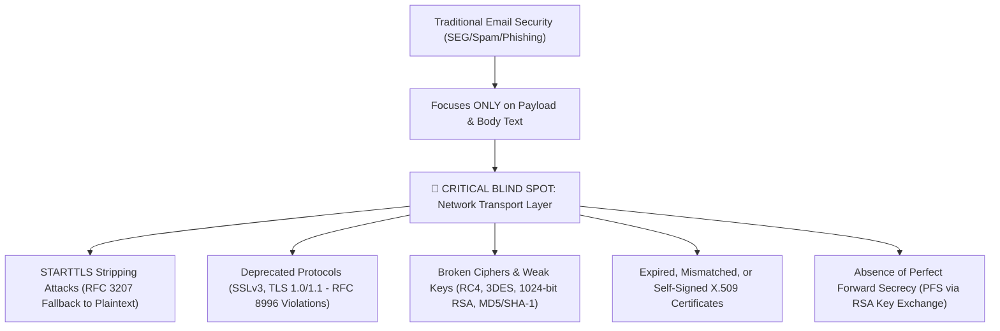
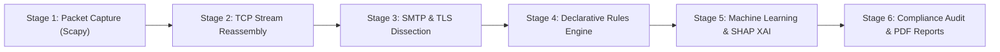

# Secure SMTP — Judges' Pitch Deck & Technical Blueprint
**AI-Assisted Cryptographic Security Posture Assessment for Secure Email Communications**

---

## 1. The 60-Second Elevator Pitch (Word-for-Word Opening)

> *"Judges, over 90% of all cyberattacks begin with an email. The industry spends billions on spam filters, phishing detection, and antivirus tools—yet there is a massive blind spot that almost every security suite ignores: **the cryptographic transmission layer**.*
> 
> *While organizations scan the email *body*, attackers downgrade STARTTLS handshakes, exploit deprecated TLS 1.0/1.1 protocols, harvest traffic using weak 1024-bit RSA keys, and hijack mail transfer agents via man-in-the-middle attacks.*
> 
> *Introducing **Secure SMTP**—the first AI-assisted cryptographic intelligence platform designed specifically for email infrastructure. Secure SMTP passively intercepts and reconstructs raw network PCAPs, performs deep X.509 and cipher audit without inspecting message payloads (preserving 100% privacy), and uses **Explainable AI (XGBoost + SHAP)** to detect subtle cryptographic anomalies and benchmark servers against NIST SP 800-52r2 and PCI-DSS v4.0 in seconds.*
> 
> *Let us walk you through how we bring zero-trust cryptographic posture to mission-critical email."*

---

## 2. The Core Problem & Industry Blind Spot



### Why Existing Tools Fail:
1. **Wireshark / tcpdump:** Require manual, packet-by-packet forensics. A security analyst cannot manually inspect 50,000 email handshakes daily.
2. **Secure Email Gateways (Proofpoint / Mimecast):** Terminate TLS and inspect content, but do not provide continuous posture analytics on upstream/downstream MTA-to-MTA cryptographic negotiations.
3. **Traditional SIEMs:** Only log simple success/failure events; they lack deep ASN.1 DER certificate decapsulation and cipher suite strength auditing.

---

## 3. The Secure SMTP Solution & 6-Stage Pipeline

Secure SMTP processes raw network captures through a high-assurance, zero-payload 6-stage architecture:



| Stage | Name | Description & Tech |
|---|---|---|
| **1 & 2** | **Ingest & TCP Reassembly** | Ingests `.pcap`/`.pcapng` files or live network taps via **Scapy**. Reassembles TCP segments, handles out-of-order packets, and tracks bidirectional client-server dialogues. |
| **3** | **TLS & X.509 Dissection** | Extracts Client Hello / Server Hello, negotiated cipher suites, TLS version (SSLv3 up to TLS 1.3), ALPN, SNI, and decodes ASN.1 DER X.509 certificates (key length, signature algorithm, SAN/CN validity, expiration). |
| **4** | **Rule Evaluation Engine** | Declarative YAML-based ruleset (`ruleset.yaml`) evaluating deterministic flaws: deprecated versions, non-PFS key exchange, weak hashes (MD5, SHA-1), and certificate expirations. |
| **5** | **AI Risk Scoring & SHAP XAI** | **XGBoost & Scikit-Learn (Isolation Forest)** compute multi-factor risk scores (0–100) and flag statistical baseline deviations. **SHAP (Shapley Additive exPlanations)** explains exact feature attributions. |
| **6** | **Reporting & Remediation** | Benchmarks sessions against NIST SP 800-52r2, PCI-DSS v4.0, and HIPAA. Generates executive PDF audit reports via **WeasyPrint / Jinja2**. |

---

## 4. Key Differentiators & Competitive Advantage

### 1. Zero-Payload Privacy (Privacy-by-Design)
* Secure SMTP inspects **only the cryptographic envelope** (TLS handshake, certificate metadata, SMTP response codes).
* **Zero email bodies, subjects, or attachments** are ever read, stored, or processed.
* Guarantees strict compliance with **GDPR, HIPAA, and corporate confidentiality policies**.

### 2. Explainable AI (Not a Black Box)
* Traditional ML models output an opaque score (e.g. *"Score: 84"*). Judges love knowing **WHY**.
* Using **SHAP**, Secure SMTP breaks down the score into exact feature attributions:
  * `+35 points`: RSA Key Exchange without Forward Secrecy
  * `+28 points`: Deprecated TLS 1.0 Protocol
  * `+18 points`: Self-Signed Certificate Authority
  * `-10 points`: Valid Subject Alternative Name (SAN) match

### 3. Integrated Interactive Controlled Mail Lab
* Includes a built-in virtual testing laboratory with live listeners on dedicated ports:
  * **Port 2525:** Plaintext SMTP (RFC 5321 Cleartext attack simulation)
  * **Port 2526:** Modern TLS 1.3 (AEAD Cipher, Pristine PFS score)
  * **Port 2527:** Expired Cert & Legacy 1024-bit RSA
* Allows security teams to test and benchmark SIEM alerts without risking production mail systems.

### 4. Dual Database Architecture
* **MongoDB Atlas:** High-throughput document store for session logs, hosts, jobs, and user access.
* **Neo4j Graph Database:** Optional enterprise topology engine mapping cross-server shared vulnerabilities (e.g., discovering which 15 internal mail servers all share the same vulnerable certificate or cipher).

---

## 5. Complete Technical Stack

```
Frontend:
  ├── React 18 (Single Page Architecture)
  ├── Vite (Lightning-fast HMR & Build)
  ├── TailwindCSS & CSS Variables (Dark/Light Cyber Defense Theme)
  ├── Lucide Icons & Plotly (Interactive visual analytics)
  └── Native WebSockets (Real-time live session streaming)

Backend & Core Engine:
  ├── Python 3.11+
  ├── FastAPI (Asynchronous REST API + OpenAPI Documentation)
  ├── Uvicorn (High-performance ASGI server)
  ├── Pydantic v2 (Strict type-safe schemas & validation)
  └── Scapy (Network packet decapsulation & TCP stream reassembly)

Cryptography & Security:
  ├── pyca/cryptography (ASN.1 DER parsing, X.509 verification, cipher suite mapping)
  ├── PyJWT (RS256 & HS256 stateless session tokens)
  └── PBKDF2-HMAC-SHA256 (Salted cryptographic password hashing)

Artificial Intelligence & Analytics:
  ├── Scikit-Learn (Isolation Forest for anomaly detection)
  ├── XGBoost (Gradient Boosted Decision Trees for risk scoring)
  ├── SHAP (TreeExplainer for cryptographic feature attribution)
  └── NumPy & Pandas (Feature extraction vectorization)

Databases & Storage:
  ├── MongoDB Atlas (Primary NoSQL Document Store via PyMongo)
  └── Neo4j 5.x (Graph Database for MTA network topology & shared weaknesses)

Reporting:
  ├── WeasyPrint & ReportLab (Server-side PDF generation)
  └── Jinja2 (Cryptographic audit templating)
```

---

## 6. Live Demo Script (Step-by-Step 3 to 5 Minute Demo)

| Time | Screen / Action | What to Say to the Judges |
|---|---|---|
| **0:00 - 0:45** | **Fleet Overview (`/dashboard/fleet`)** | *"Welcome to the Secure SMTP Command Center. Here we see our global email infrastructure posture. At a glance, the system monitors active mail transfer agents, tracking their compliance status, cipher distributions, and security regressions."* |
| **0:45 - 1:45** | **Live Ingest & PCAP Upload (`/dashboard/live`)** | *"Let's simulate an enterprise security assessment. I am uploading a raw network packet capture: `smtp_implicit_weak_cipher.pcap`. Within 2 seconds, our asynchronous Python worker parses the raw packets, reconstructs the TCP stream, decodes the TLS handshake, and passes it through our rules and ML models."* *(Click Analyze capture -> Show green success banner)* |
| **1:45 - 2:45** | **Session Explorer & Deep Dive (`/dashboard/sessions`)** | *"Here is the decoded session. Notice what we see: Protocol negotiated is TLS 1.0, cipher is 3DES-EDE-CBC-SHA, and the RSA key is only 1024 bits. More importantly, notice what we DO NOT see: no email content, no body text, no sender credentials. We achieve total visibility with total privacy."* |
| **2:45 - 3:30** | **Explainable AI (SHAP Insights)** | *"Instead of giving the analyst a generic alert, our AI Risk Engine scores this session as High Risk (88/100). Our SHAP explainability panel shows the exact mathematical contribution: 40% driven by deprecated TLS 1.0, 30% by the 1024-bit key, and 20% by the non-AEAD cipher."* |
| **3:30 - 4:15** | **Rules & Compliance (`/dashboard/compliance`)** | *"Organizations must comply with federal and industry mandates. With one click, Secure SMTP audits this session against NIST SP 800-52r2, PCI-DSS v4.0 Requirement 4.1, and HIPAA. It instantly highlights failed checks and prescribes actionable remediation steps."* |
| **4:15 - 5:00** | **Executive PDF Report Export** | *"Finally, for leadership and compliance auditors, we can export an audit-ready, tamper-evident cryptographic report in PDF format in one click. This bridges the gap between low-level network engineers and C-level security executives."* |

---

## 7. Regulatory Compliance Matrix

Secure SMTP automates compliance checking against the world's most stringent cryptographic frameworks:

| Standard | Clause / Section | Requirement | Secure SMTP Audit Logic |
|---|---|---|---|
| **NIST SP 800-52 Rev. 2** | Section 3.1 | Mandatory TLS 1.2 minimum; TLS 1.3 strongly recommended. Deprecate TLS 1.0/1.1. | Fails sessions negotiating `< TLS 1.2`. Flags missing TLS 1.3 extensions. |
| **NIST SP 800-52 Rev. 2** | Section 3.3.1 | Ephemeral Diffie-Hellman (ECDHE/DHE) mandatory for forward secrecy. | Fails static RSA key exchange; checks elliptic curve parameters ($P \ge 256$). |
| **PCI-DSS v4.0** | Requirement 4.1 | Strong cryptography for cardholder data in transit over open/public networks. | Flags 3DES, RC4, CBC-mode ciphers without Encrypt-then-MAC, and weak RSA keys. |
| **HIPAA Security Rule** | 45 CFR § 164.312(e)(1) | Transmission security of ePHI over public networks. | Audits end-to-end encryption and rejects cleartext STARTTLS fallback. |
| **RFC 8996 / RFC 8446** | IETF Standard | Formal deprecation of SSLv3, TLS 1.0, and TLS 1.1 across all Internet protocols. | Automated high-severity finding on legacy version negotiation. |

---

## 8. Judges' Tough Questions & Winning Defense Cheatsheet

### Q1: *"How is this different from Wireshark or Zeek (Bro)?"*
> **Answer:** *"Wireshark is an interactive diagnostic tool for packet analysts; it does not provide automated fleet-wide posture scoring, compliance auditing, or AI explainability. Zeek is an excellent network security monitor, but it requires writing complex custom scripts to extract deep X.509 certificate chains and lacks built-in compliance frameworks (NIST/PCI-DSS) and automated executive PDF reporting. Secure SMTP is a specialized, turn-key cryptographic intelligence platform designed specifically for email infrastructure."*

### Q2: *"Why do you need Machine Learning? Couldn't simple regex or if-else rules do this?"*
> **Answer:** *"Deterministic rules are essential for known CVEs and static version checks (Stage 4). However, real-world email networks suffer from subtle anomalies that rules miss—such as sudden shifts in cipher suite preference distributions, unusual client-server extension combinations, or slow cryptographic degradation across thousands of servers. Our Isolation Forest and XGBoost models detect zero-day anomalies and multivariate posture drift, while SHAP ensures that every AI decision is transparent and explainable."*

### Q3: *"How do you guarantee user privacy under GDPR / HIPAA?"*
> **Answer:** *"Our parser architecture operates strictly at the TCP and TLS Handshake layers. The ingestion engine strips and ignores SMTP DATA payloads before any persistent storage. We only persist cryptographic metadata (ciphers, key lengths, certificates, and IP addresses). No email subjects, body text, or attachments ever touch our database."*

### Q4: *"How does this scale to millions of emails per day?"*
> **Answer:** *"Our pipeline is decoupled: the ingestion worker runs asynchronously in non-blocking worker processes, and the database utilizes MongoDB Atlas with horizontal sharding capabilities. In production, passive network collectors (like `secure-smtp-agent`) run at the network edge on SPAN/mirror ports, process packet headers locally in memory, and stream only lightweight metadata over HTTPS/WebSockets, keeping bandwidth and storage overhead minimal."*

### Q5: *"Why did you use both MongoDB and Neo4j?"*
> **Answer:** *"We use polyglot persistence to solve two fundamentally different problems: MongoDB is our high-performance document store for time-series sessions, raw findings, and audit logs. Neo4j is our graph engine that models cross-server relationships. In large enterprise fleets, Neo4j allows us to run Cypher graph queries to immediately discover shared blast radiuses—such as 20 different mail servers that all share the same vulnerable intermediate CA certificate."*

---

## 9. Future Roadmap & Enterprise Potential

1. **Automated MTA-STS & DANE Enforcement:** Integrating automated DNSSEC, TLSA record generation, and RFC 8461 policy publishing to proactively prevent downgrade attacks.
2. **Post-Quantum Cryptography (PQC) Readiness:** Auditing algorithms against NIST PQC standards (ML-KEM / Kyber and ML-DSA / Dilithium) to prepare enterprise email for the quantum era.
3. **SOAR & SIEM Integrations:** Webhook connectors for Splunk, Microsoft Sentinel, and Cortex XSOAR for automated blocking of rogue mail servers.
4. **Cloud-Native Kubernetes Operator:** Deploying daemonset network sniffers across Amazon EKS and Google GKE clusters for automated zero-touch email posture monitoring.
